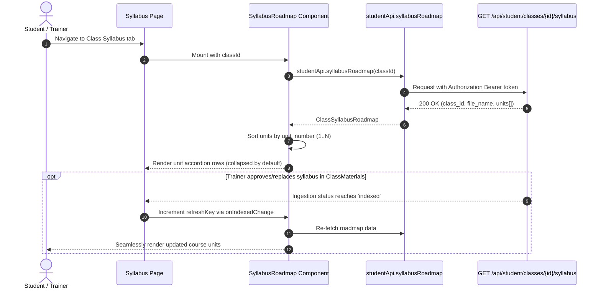

# UI Design — Course Syllabus Roadmap & Session Outline (AI-133)

> **Ticket:** AI-133 · **Status:** Implemented (UI & client logic)  
> **Backend story:** AI-133 (*Parse Course Units and Topic Outline from Syllabus Markdown*)  
> **Endpoint contract:** `GET /api/student/classes/{class_id}/syllabus`

This document specifies the design and implementation of the **Syllabus Roadmap** feature on the frontend: displaying structured, sequential course units and session outlines parsed from approved syllabus documents on both the Student and Teacher class workspaces.

---

## 1. Purpose and users

- **Student / Teaching Assistant:**
  - Views the overall learning roadmap of the enrolled class in strict sequential order (`01..N`).
  - Expands individual units or uses *Expand all / Collapse all* to inspect session details (lectures, labs, quizzes, training formats, and duration).
  - Searches through unit titles, descriptions, and session content using the client-side search bar.
  - Retains access to the class approved materials list below the roadmap.
- **Academic Trainer:**
  - Reviews the parsed course units and session outlines generated from their uploaded & approved syllabus files (`.xlsx`, `.xls`, or `.md`).
  - Replaces or re-uploads syllabus files in the *Materials* section below; once indexing completes, the roadmap automatically re-fetches and updates without a manual page refresh.
  - Mock preview badge and static sample data are removed in favor of real database records.

---

## 2. Routes and touchpoints

| Route | Touchpoint | Role | Description |
|---|---|---|---|
| `/student/class/[id]/syllabus` | Top section | Student / TA | Displays `<SyllabusRoadmap classId={id} />` above the approved materials table. |
| `/teacher/class/[id]/syllabus` | Top section | Trainer | Displays `<SyllabusRoadmap classId={id} isTeacher refreshKey={refreshKey} />` above `<ClassMaterials classId={id} />`. |
| `components/shared/SyllabusTable.tsx` | Shared component | Both | Reusable accordion roadmap with search, unit badge, expand/collapse, and empty states. |
| `features/chat/chat-markdown.tsx` | Content renderer | Both | Hierarchical, XSS-safe Markdown rendering for unit sessions and outline notes. |
| `features/documents/class-materials.tsx` | Lifecycle trigger | Trainer | Emits `onIndexedChange` when document indexing completes (`processing` → `indexed`) or a document is deleted. |

---

## 3. Layout and behaviour

### Header & Controls
- **Title & Source Badge:**
  - Displays `Syllabus` heading.
  - When `file_name` is present, displays a compact badge (`<FileText /> {file_name}`) indicating the source syllabus file.
- **Search bar:**
  - Placed on the right of the header, filters units in real time by `unit_title`, `description`, or `content`.
  - When a search query is active, matching units are automatically expanded so the matching content is immediately visible.
- **Expand all / Collapse all:**
  - Toggles all visible units simultaneously.
  - Initial load state defaults to **all units collapsed** (`expandedIds = {}`) for a clean overview.

### Unit Accordion Rows
- **Unit Numbering:**
  - Sequential two-digit badge (`01`, `02`, …) derived from `unit_number` sorted ascending (`a.unit_number - b.unit_number`).
- **Unit Information:**
  - `unit_title` displayed prominently with bold font.
  - `description` (e.g. `2 sessions · OS1`) displayed as a muted caption.
- **Expand/Collapse Action:**
  - Clickable row header with chevron indicator (`ChevronRight` when collapsed, `ChevronDown` when expanded).
  - Screen-reader accessible with `aria-expanded={isExpanded}`.
- **Session Outline Content (Expanded):**
  - Rendered via `<ChatMarkdown content={stripNotesLines(unit.content)} />`.
  - Preserves hierarchical structure:
    - Session headers (`### Session 1`) render as `<h3>`.
    - Main session items (`- **Concept/Lecture** (...)`) render as top-level `<li>`.
    - Sub-bullet points (`  - Tokenization: ...`) render as nested `<ul className="list-[circle]">`.
  - Legacy `*Notes:*` lines from previously indexed data are stripped client-side.

### Scroll & Layout Stability
- `app/(shell)/teacher/class/[id]/layout.tsx` and `app/(shell)/student/class/[id]/layout.tsx` utilize `min-h-0 overflow-hidden` on the outer workspace wrapper.
- This isolates scrolling strictly to the inner content pane (`overflow-y-auto`), keeping the course banner and tabs pinned to the top and preventing ghost blank whitespace at the bottom.
- File input elements in `ClassMaterials` use `className="hidden"` rather than `sr-only` to prevent browsers from jumping or scrolling down upon file selection.

---

## 4. States

| State | Student UI | Trainer UI |
|---|---|---|
| **Loading** | Bordered card: `Loading syllabus roadmap…` | Bordered card: `Loading syllabus roadmap…` |
| **Empty** | `No syllabus roadmap yet — your trainer hasn't published an approved syllabus for this class.` | `No syllabus roadmap yet — upload and approve a Syllabus file (.xlsx, .xls, or .md) in Materials below to generate course units.` |
| **Search Empty** | `No units match "<search_query>".` | `No units match "<search_query>".` |
| **Error** | Red-accented alert box with error detail and `Retry` button | Red-accented alert box with error detail and `Retry` button |
| **Populated** | Ordered accordion units (default collapsed), with source file badge and search controls | Ordered accordion units, with real-time reload on document approval/indexing |

---

## 5. Data and API flow



### TypeScript Data Contracts (`lib/student-api.ts`)

```typescript
export type SyllabusUnit = {
  id: string;
  unit_number: number;
  unit_title: string;
  description: string | null;
  content: string;
};

export type ClassSyllabusRoadmap = {
  class_id: string;
  document_id: string | null;
  file_name: string | null;
  topic_outline: string | null;
  units: SyllabusUnit[];
};
```

---

## 6. Security and Accessibility

- **XSS Prevention (AC-07):**
  - Session markdown outlines are processed without `dangerouslySetInnerHTML`.
  - Content maps directly to standard React virtual DOM elements (`<h3>`, `<ul>`, `<li>`, `<strong>`, `<em>`, `<p>`).
  - Injected script tags (`<script>`, ``, etc.) are rendered as inert string literals.
- **Accessibility (A11y):**
  - Accordion triggers are semantic `<button>` elements with `aria-expanded` and clear labels.
  - Search input has explicit `aria-label="Search syllabus units"`.
  - High-contrast typography adhering to WCAG 2.1 AA standards.

---

## 7. Verification and Automated Tests

- **Unit Tests (`lib/syllabus-roadmap.test.ts`):**
  - Verifies `studentApi.syllabusRoadmap` endpoint mapping for populated roadmap and empty syllabus responses.
  - Verifies nested bullet hierarchy and bold badge rendering in `ChatMarkdown`.
  - Verifies XSS payloads are escaped cleanly.
- **Test execution:**
  ```bash
  npm run test -- lib/syllabus-roadmap.test.ts
  npm run lint
  ```

