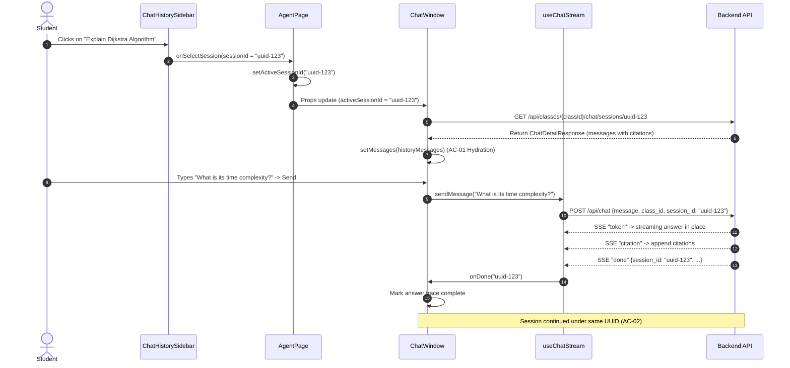

# UI Design & Implementation Specs — Reopen an Old Conversation & Continue (AI-97)

> **Ticket:** [AI-97](https://ai03.atlassian.net/browse/AI-97)  
> **Epic:** AI-93 (Chat History & Memory)  
> **Repo:** `course-qa-agent-fe`  
> **Target branch:** `features/Design_ReopenConversation`  
> **Status:** Implemented (UI & Client State Integration)  

This document defines the frontend interaction architecture, component hierarchy, state flow, and data contracts for **AI-97: Reopen an Old Conversation & Continue**.

> **Figma Note:** No dedicated Figma screen was issued for this ticket because it extends the existing student & teacher agent chat layout established in AI-59 and AI-95. This document serves as the formal UI specification for the Design branch according to the team's GitLab workflow guide (§3.2.1).

---

## 1. Overview & Objectives

In previous stories (AI-59, AI-95), students could chat with the Academic Agent and view past session titles in the sidebar. However, reopening an old conversation did not seamlessly bind the conversation state to subsequent chat turns.

AI-97 closes this gap by ensuring:
1. **Context Memory Hydration (AC-01):** Clicking an old session in the history sidebar immediately loads the full message transcript and restores citations into the active chat window.
2. **Session Continuity (AC-02):** Submitting a new question inside a reopened session keeps the same `session_id`, streaming the answer in place and appending the new turn to the existing conversation in the database.
3. **Session Isolation (AC-03):** Clicking "New Chat" resets the session state (`session_id = null`), ensuring the next question starts an entirely fresh session without leaking historical context or message state.

---

## 2. Component Scope & File Changes

| Area | File | Change Description |
|---|---|---|
| **Page Shell** | `app/(shell)/student/class/[id]/agent/page.tsx` | Owns `activeSessionId` and `refreshTrigger`. Coordinates session selection, "New Chat" resets, and sidebar revalidation upon session creation. |
| **Page Shell (Teacher)** | `app/(shell)/teacher/class/[id]/agent/page.tsx` | Mirrors student agent state management for teacher role review. |
| **Chat Container** | `features/chat/chat-window.tsx` | Receives `activeSessionId` and `onSessionCreated`. Fetches session details via `historyApi.getSessionDetail()`, hydrates messages, and passes `sessionId` to `useChatStream`. |
| **Stream Hook** | `hooks/use-chat-stream.ts` | Accepts `sessionId?: string | null`. Sends `session_id` in `POST /api/chat` payload. Extracts `session_id` from SSE `done` event and forwards it via `onDone(sessionId)`. |
| **SSE Client** | `lib/sse.ts` | Extends `SseDonePayload` with `session_id?: string` to deserialize backend metadata. |
| **Sidebar** | `features/history/chat-history-sidebar.tsx` | Listens to `refreshTrigger` to automatically refetch sessions after a first question creates a session title. Highlights active session. |

---

## 3. Component Hierarchy & Props Flow

```
+-----------------------------------------------------------------------------------------+
|                                        AgentPage                                        |
|  State:                                                                                 |
|    - activeSessionId: string | null (active conversation)                               |
|    - refreshTrigger: number (increments on new session created)                         |
+-----------------------------------------------------------------------------------------+
       |                                                               |
       | (classId, activeSessionId, onSelectSession)                   | (classId, activeSessionId, onSessionCreated)
       v                                                               v
+------------------------------------+        +-------------------------------------------+
|         ChatHistorySidebar         |        |                ChatWindow                 |
|                                    |        |                                           |
|  - Renders session items           |        |  State:                                   |
|  - Highlights active session       |        |    - messages: ChatMessage[]              |
|  - "New Chat" -> setActiveId(null) |        |    - isLoadingHistory: boolean            |
|  - Re-fetches on refreshTrigger    |        |                                           |
+------------------------------------+        +-------------------------------------------+
                                                               |
                                                               | (classId, sessionId: activeSessionId, onDone)
                                                               v
                                              +-------------------------------------------+
                                              |               useChatStream               |
                                              |                                           |
                                              |  - Sends: { message, class_id, session_id}|
                                              |  - Receives SSE stream (token, citation)  |
                                              |  - Parses `done` event -> calls onDone()  |
                                              +-------------------------------------------+
```

---

## 4. User Interaction & UX Flows

### 4.1 Flow 1: Reopening an Old Session & Continuing (AC-01, AC-02)



### 4.2 Flow 2: Starting a New Chat & Context Isolation (AC-03)

1. Student clicks **"New Chat"** in the sidebar header.
2. `Sidebar` fires `onSelectSession(null)`.
3. `AgentPage` sets `activeSessionId = null`.
4. `ChatWindow` detects `activeSessionId === null`, clears messages (`setMessages([])`), and resets composer state.
5. Student sends question *"What is Docker?"*.
6. `useChatStream` sends `POST /api/chat` with `session_id: null`.
7. Backend creates a new session `uuid-456`, returns `done` event with `session_id: "uuid-456"`.
8. `ChatWindow` triggers `onSessionCreated("uuid-456")`.
9. `AgentPage` updates `activeSessionId = "uuid-456"` and increments `refreshTrigger`.
10. `ChatHistorySidebar` refetches the list, showing the newly titled session at the top.

---

## 5. Data Contracts & Interfaces

### 5.1 SSE Done Event (`lib/sse.ts`)

```typescript
export interface SseDonePayload {
  session_id?: string;
  user_message_id?: string;
  assistant_message_id?: string;
  route?: string;
}
```

### 5.2 Hook Interface (`hooks/use-chat-stream.ts`)

```typescript
export interface UseChatStreamProps {
  classId: string;
  sessionId?: string | null;
  onChunk: (chunk: string, elapsedMs: number) => void;
  onProgress?: (stage: ChatProgressStage) => void;
  onCitation?: (citation: ChatCitation) => void;
  onDone?: (sessionId?: string) => void;
  onError?: (error: Error) => void;
}
```

### 5.3 ChatWindow Props (`features/chat/chat-window.tsx`)

```typescript
export interface ChatWindowProps {
  classId: string;
  activeSessionId?: string | null;
  onSessionCreated?: (sessionId: string) => void;
}
```

---

## 6. Edge Cases & Resilience

1. **Session Switching Mid-Stream:**
   - If the student clicks another session while an answer is actively streaming, `useChatStream` aborts the current fetch controller to prevent tokens from spilling into the newly loaded transcript.
2. **Invalid / Stale Session ID:**
   - If a session was deleted or belongs to another user, `historyApi.getSessionDetail()` returns `404 Not Found` or `403 Forbidden`. `ChatWindow` toasts an error and falls back gracefully to `activeSessionId = null` (New Chat mode).
3. **Empty Session Transcript:**
   - If a session has no messages, the chat window displays the default friendly greeting without throwing an index error.
4. **Citation Integrity:**
   - Messages loaded from `getSessionDetail()` retain their exact original citation list, matching what was streamed when the answer was generated.

---

## 7. Acceptance Criteria Verification

| AC Code | Requirement | Frontend Implementation Verification | Status |
|---|---|---|---|
| **AC-01** | Mở session cũ → load đúng nội dung tin nhắn cũ | `historyApi.getSessionDetail` fetches full transcript; `ChatWindow` maps them to `ChatMessage` objects with citations. | **PASS** |
| **AC-01** | LLM nhận đúng history context khi tiếp tục session | `activeSessionId` is passed down to `useChatStream` which includes `session_id` in request body. | **PASS** |
| **AC-02** | Câu hỏi mới trong session cũ → AI trả lời có ngữ cảnh liên tục | Backend `done` SSE emits same `session_id`; messages append seamlessly to transcript without page refresh. | **PASS** |
| **AC-03** | New Chat → tuyệt đối không dùng lại ngữ cảnh phiên cũ | "New Chat" resets `activeSessionId` to `null`; `POST /api/chat` sends `session_id: null` creating a fresh conversation. | **PASS** |
