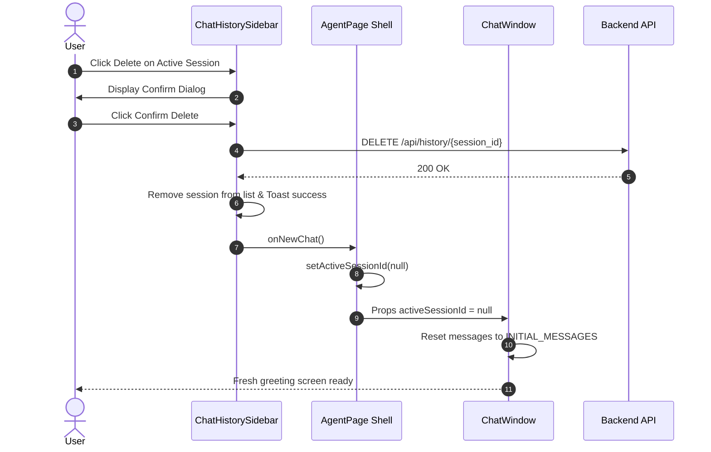

# UI/UX Design & Interaction Specs — Delete Chat History (AI-99)

> **Ticket:** [AI-99](https://ai03.atlassian.net/browse/AI-99)  
> **Epic:** AI-93 (Chat History & Memory)  
> **Repo:** `course-qa-agent-fe`  
> **Target branch:** `features/Design_DeleteChatHistory`  
> **Status:** Implemented (UI & Client State Integration)  

This document defines the user interface specifications, interactive states, accessibility guidelines, and component contracts for **AI-99: Delete Chat History**.

> **Figma Note:** No dedicated Figma screen was issued for this ticket because it reuses the established design system tokens, Radix UI Dialog primitives, and Lucide icons standardized in AI-59, AI-95, and AI-97. This specification serves as the formal design deliverable for the Design branch according to the team's GitLab workflow guide (§3.2.1).

---

## 1. Overview & Objectives

Students engage in multiple exploratory or sensitive conversations with the Academic Agent. To safeguard personal privacy and keep the workspace uncluttered, students require the capability to permanently delete any conversation they own.

### Acceptance Criteria (AC) Mapping
* **AC-01 — Confirmation Dialog & Independence:** Deleting a session requires explicit user confirmation via an accessible modal dialog. Deleting one session never mutates or drops other conversation sessions in the sidebar.
* **AC-02 — Row-Level Ownership:** Only the session owner can delete their conversations. API errors (such as `403 Forbidden` for non-owners) are cleanly caught and presented via toast notifications without crashing the UI.
* **AC-03 — Immediate Cascade & State Cleanup:** Upon confirmed deletion, the session is removed from the sidebar. If the deleted session is currently active in the chat window, the view seamlessly resets to a fresh "New Chat" screen without leaving orphaned messages or running streaming callbacks.

---

## 2. Layout & Wireframes

### 2.1. Sidebar Action Icons
Inside `ChatHistorySidebar`, each session row contains action buttons placed at the trailing edge. The actions are hidden by default and appear on row hover or when the session is currently active.

```text
+----------------------------------------------------+
|  Chat History                              [+] [<] |
+----------------------------------------------------+
|  Explain the A* search algorithm?      [✏️]  [🗑️]   |
|  2 hours ago                                       |
+----------------------------------------------------+
|  Midterm logistics review              [✏️]  [🗑️]   |
|  Yesterday                                         |
+----------------------------------------------------+
```

### 2.2. Delete Confirmation Modal
Clicking the trash icon opens a modal dialog that prevents accidental deletion:

```text
+----------------------------------------------------+
|  Delete conversation                         [✕]   |
|                                                    |
|  Are you sure you want to delete                   |
|  "Explain the A* search algorithm?"?               |
|  This action cannot be undone.                     |
|                                                    |
|                     +------------+ +-------------+ |
|                     |   Cancel   | |   Delete    | |
|                     +------------+ +-------------+ |
+----------------------------------------------------+
```

---

## 3. Interactive States & Component Behavior

| State | Trigger / Condition | UI / System Behavior |
|---|---|---|
| **Row Idle** | Mouse not over row, not active | Action icons hidden (`opacity-0`). |
| **Row Hover / Active** | Hovering row or `activeSessionId === session.id` | Actions visible (`opacity-100`). Trash icon styled with `hover:text-red-500`. |
| **Dialog Open** | User clicks trash icon or presses `Enter`/`Space` | `setSessionToDelete(session)` triggered. Modal opens with session title; focus is trapped inside dialog. Click on trash does **not** select the row (`e.stopPropagation()`). |
| **Cancel Deletion** | Click `Cancel`, click overlay, or press `Escape` | Dialog closes immediately. State `sessionToDelete` set to `null`. Zero changes to sidebar or active session. |
| **Deleting in Progress** | Click `Delete` in dialog | `isDeleting = true`. `Delete` button displays a rotating spinner (`Loader2`). Both `Cancel` and `Delete` buttons become disabled. Closing dialog via overlay/Esc is blocked. |
| **Delete Success** | `DELETE /api/history/{id}` returns `200 OK` | 1. Modal closes.<br>2. Session item is removed from local state.<br>3. Green success toast: *"Conversation deleted."*.<br>4. If deleted session was active, `onNewChat?.()` is invoked. |
| **Delete Failure** | API returns `403`, `404`, `500`, or network error | 1. `isDeleting` resets to `false`.<br>2. Modal closes.<br>3. Red error toast: *"Delete failed: <reason>"*.<br>4. Session remains intact in the sidebar. |

---

## 4. Active Session Deletion & Edge Cases

### 4.1. Active Session Reset Flow
When a user deletes the session they are currently viewing:
1. `ChatHistorySidebar` detects `activeSessionId === sessionToDelete.id`.
2. It executes `onNewChat?.()`.
3. The parent `AgentPage` resets `activeSessionId` to `null`.
4. `ChatWindow` responds to `activeSessionId === null` by clearing the current transcript and restoring `INITIAL_MESSAGES` (the welcome placeholder and prompt suggestions).
5. The chat input is enabled and ready for a brand-new conversation turn.



### 4.2. Streaming Invalidation Guard
If a deletion occurs while a server-sent stream (SSE) is active or lingering:
* `ChatWindow` clears `streamContextRef.current` when `activeSessionId` drops to `null`.
* Callbacks from interrupted streams are discarded, preventing orphaned response chunks from being appended to an inactive transcript.

---

## 5. Accessibility (a11y) & Automation Identifiers

### 5.1. Keyboard Navigation
* **Trash Trigger Button:** Focusable via `Tab` key (`tabIndex={0}`, `role="button"`). Operable via both `Enter` and `Space` keys.
* **Modal Dialog:** Focus automatically traps within the modal when opened. `Escape` key closes the dialog (unless `isDeleting` is active).

### 5.2. Screen Readers & Copy Specifications
* **Trash Button:** `aria-label="Delete <session_title || 'conversation'>"`
* **Dialog Title:** `Delete conversation`
* **Dialog Description:** `Are you sure you want to delete "<session_title>"? This action cannot be undone.`
* **Cancel Button:** `Cancel` (ghost/outline variant)
* **Confirm Button:** `Delete` (destructive red variant)
* **Success Toast:** `Conversation deleted.`
* **Error Toast:** `Delete failed: <error_message>`

### 5.3. Test Automation Attributes (`data-testid`)
To ensure reliable End-to-End (E2E) testing and CI/CD validation, the following test IDs are bound:

| Target Element | `data-testid` | Purpose |
|---|---|---|
| Trash Icon Trigger | `delete-session-btn-${session.id}` | Pinpoint delete button for a specific session |
| Confirmation Dialog | `delete-confirm-dialog` | Assert modal presence |
| Cancel Action Button | `cancel-delete-btn` | Trigger cancellation in automation |
| Confirm Action Button | `confirm-delete-btn` | Trigger confirmed deletion in automation |

---

## 6. Data Contract & Backend Integration

### Endpoint
```http
DELETE /api/history/{session_id}
Authorization: Bearer <access_token>
```

### Expected Status Codes
* **`200 OK`**: Session and its associated messages/vectors successfully deleted.
* **`401 Unauthorized`**: Missing or expired token.
* **`403 Forbidden`**: Session belongs to another user (RLS enforcement).
* **`404 Not Found`**: Session ID does not exist or has already been deleted.

---

## 7. Responsive Behavior

| Screen Size | Behavior |
|---|---|
| **Desktop (`>= 1024px`)** | Sidebar is fixed on the left. Trash action appears on row hover/active. Confirmation modal is centered (`sm:max-w-md`). |
| **Tablet (`768px - 1023px`)** | Same layout; touch interactions show action icons upon row tap. |
| **Mobile (`< 768px`)** | Sidebar opens as an overlay drawer. Delete dialog adjusts to mobile viewport width (`w-[calc(100%-2rem)]`). |

---

## 8. Traceability & References

* **Jira Ticket:** [AI-99: Delete Chat History](https://ai03.atlassian.net/browse/AI-99)
* **Backend Design Spec:** `course-qa-agent-be/docs/design/ai-99-delete-chat-history.md`
* **Related Frontend Specs:**
  * AI-95: Save & Display Chat History (`docs/design/ai-95-ui-chat-history.md`)
  * AI-95: Rename Conversation UI (`docs/design/ai-95-chat-rename-ui.md`)
  * AI-97: Reopen Conversation UI (`docs/design/ai-97-ui-reopen-conversation.md`)
